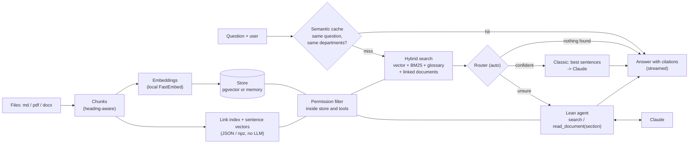

# knowledge-search

Ask questions about internal documents in plain German, get answers with clickable sources, and make sure everyone only sees what their department may read.


**Demo:** https://omaraldulimay.github.io/knowledge-search/ (live after the first deploy; precomputed answers, no server)

## What it does

- **Answers with sources.** Every claim carries a citation (document, section, chunk) that opens the original text.
- **Three search modes, measured against each other.** Classic RAG (search once), an agent that calls search tools itself, and `auto`, which picks one per question from the search results.
- **Rights are enforced in the data layer.** A user never receives a chunk of a department they do not belong to.
- **Quality and cost are visible.** 30 eval questions plus 15 held-out ones, live request log, a scale test with 10,000 filler documents, an ablation of every cost lever.

Fictional company ("Elbkontor Logistik GmbH"), 35 invented German documents (md, pdf, docx), five demo users.

## Architecture



## Three modes

| | Auto (default) | Classic ("Einmal suchen") | Agentic ("KI sucht selbst") |
|---|---|---|---|
| Flow | search, then the router decides | hybrid search once, best sentences go into the prompt | model calls `search`, `read_document(doc, section)`, `list_documents` itself |
| Strength | cheap for easy questions, thorough for unsure ones, free when nothing is found | fast, cheap, predictable | can combine two documents, re-search with better terms |
| Cost | between the two, see the ablation below | 1 model call | up to 4 tool calls (6 in the baseline agent) |
| UI | answer + sources + what the router chose | answer + sources | answer + sources + timeline of the steps |

## Results

30 questions: 14 single-document, 8 need two documents, 4 not in any document, 4 only in documents the user must not see.

Baseline before the optimisation work. Real run with **Claude Haiku 5.5** (`claude-haiku-5-5`), 30 questions, both modes (`eval/results.json`); the optimised numbers follow in the next section:

| | Classic | Agentic |
|---|---|---|
| Right document in top 5 | 100 % | 100 % |
| Both documents retrieved (8 two-doc questions) | 86 % | 100 % |
| Citation correct / "not found" correct | 100 % | 100 % |
| Permission leaks | 0 | 0 |
| Latency p50 / p95 | 1.4 s / 1.9 s | 3.4 s / 5.2 s |
| Avg tokens per question (in / out) | 1,033 / 224 | 5,442 / 450 |
| Cost per question | $0.0002 | $0.0008 |
| Cost for all 30 questions | $0.0065 | $0.0231 |

Cost stays low because the prompt only carries the top 5 chunks, the agent is capped at 6 tool calls, answers are short (`effort: low`), and the demo export reuses the eval answers instead of asking twice.

## Kosten & Tempo optimieren

The baseline was "okay": 1,033 input tokens and $0.21 per 1,000 questions for classic, 5,261 tokens and $0.76 for the agent. The goal was cheaper and faster **without** losing quality, through retrieval design instead of prompt tweaks. Five levers, each one switchable (`ks/config.py`), measured one after the other (`python -m ks.cli optimize`, results in `eval/optimization.json`, every real answer in `eval/optimization_answers.json`).

**How it was measured.** Real Claude Haiku 5.5, one run per row, on two question sets: the 30 *tuning* questions (used to choose thresholds) and 15 *held-out* questions (`eval/holdout.yaml`): everyday wording, abbreviations, synonyms, written and committed before any tuning and never tuned against. "fact" = the answer contains the numbers/terms of the right answer (`eval/facts.yaml`), "citation" = cites the right document, or says "not found" when it should. Hit@5, "both docs", leaks and routing do not need a model and are also recorded offline with `FakeLLM`. Prices: $0.10 / $0.50 per million tokens. Total API spend for all of it, including probes and the demo export: about $0.20.

**Tuning set (30 questions)**

| Configuration | hit@5 | both docs | citation | fact | leaks | p50 / p95 | TTFT p50 | tokens in / out | $ / question | $ / 1,000 |
|---|---|---|---|---|---|---|---|---|---|---|
| baseline | 100% | 86% | 100% | 91% | 0 | 1.28 / 1.84 s | 0.62 s | 1,033 / 211 | $0.00021 | $0.21 |
| +compression | 100% | 86% | 97% | 86% | 0 | 1.03 / 1.61 s | 0.65 s | 581 / 97 | $0.00011 | $0.11 |
| +glossary | 100% | 91% | 97% | 86% | 0 | 1.10 / 1.33 s | 0.66 s | 595 / 103 | $0.00011 | $0.11 |
| +graph | 100% | 95% | 97% | 82% | 0 | 1.07 / 1.35 s | 0.62 s | 597 / 100 | $0.00011 | $0.11 |
| +router (auto) | 100% | 95% | 93% | 82% | 0 | 1.04 / 1.91 s | 0.61 s | 830 / 113 | $0.00014 | $0.14 |
| +cache (43 q. with repeats) | 100% | 97% | 93% | 83% | 0 | 1.02 / 2.09 s | 0.61 s | 693 / 94 | $0.00012 | $0.12 |
| baseline (agentic) | 100% | 100% | 100% | 86% | 0 | 3.20 / 5.84 s | 2.49 s | 5,261 / 466 | $0.00076 | $0.76 |
| agentic (all levers) | 100% | 100% | 97% | 73% | 0 | 2.06 / 2.54 s | 1.60 s | 2,455 / 212 | $0.00035 | $0.35 |

**Held-out set (15 questions)**

| Configuration | hit@5 | both docs | citation | fact | leaks | p50 / p95 | TTFT p50 | tokens in / out | $ / question | $ / 1,000 |
|---|---|---|---|---|---|---|---|---|---|---|
| baseline | 100% | 91% | 47% | 27% | 0 | 0.02 / 2.93 s | 0.72 s | 645 / 147 | $0.00014 | $0.14 |
| +compression | 100% | 91% | 47% | 27% | 0 | 0.02 / 1.06 s | 0.58 s | 341 / 42 | $0.00006 | $0.06 |
| +glossary | 100% | 91% | 67% | 55% | 0 | 0.91 / 1.27 s | 0.67 s | 438 / 61 | $0.00007 | $0.07 |
| +graph | 100% | 91% | 67% | 55% | 0 | 0.92 / 1.10 s | 0.62 s | 438 / 63 | $0.00008 | $0.08 |
| +router (auto) | 100% | 91% | 87% | 82% | 0 | 1.03 / 2.29 s | 0.65 s | 1,104 / 111 | $0.00017 | $0.17 |
| +cache (21 q. with repeats) | 100% | 94% | 86% | 82% | 0 | 1.01 / 2.07 s | 0.65 s | 880 / 85 | $0.00013 | $0.13 |
| baseline (agentic) | 100% | 100% | 93% | 100% | 0 | 3.31 / 4.68 s | 2.66 s | 5,466 / 473 | $0.00078 | $0.78 |
| agentic (all levers) | 100% | 100% | 93% | 91% | 0 | 2.10 / 2.53 s | 1.43 s | 2,685 / 228 | $0.00038 | $0.38 |

*Read the tables with care.* "both docs" = share of answerable questions whose expected documents were all retrieved (the baseline's 86 %; for the 8 two-document questions alone it went from 62 % to 88 %). Every run is one sample of a model whose temperature cannot be set (Haiku 5.5), so on 22 / 11 answerable questions a difference of one or two questions is noise. The baseline row on the held-out set looks fast and cheap only because its strict relevance gate answered "not found" to 8 of 15 questions, 5 of which are answerable (citation 47 %). `+cache` is measured on a workload with about 30 % repeats (43 and 21 requests), so its averages are over more requests than the other rows.

### The levers

1. **Document links ("graph-lite").** At ingest a JSON index (`links.json`) links documents by (a) explicit references (a document names another's title or file name, or "siehe ..."), (b) TF-IDF key terms per document, (c) rare key terms two documents share. At search time the best chunk of a strongly linked document is added if it is similar enough to the question (cosine at least 0.5). Permissions are applied inside the store, so a link into a forbidden department adds nothing (tests in `tests/test_optimize.py`). *Effect:* "both docs" 91 % to 95 % on the tuning set (the target was 95 %), no change on the held-out set. It rescued one question; the other links mostly add a weak extra chunk, which the compression then usually drops. A modest lever.
2. **Glossary / query expansion.** `data/glossary.yaml` holds synonym groups (bAV, Urlaub/Ferien, HO, MFA/Zwei-Faktor, ...); two acronym and compound groups were seeded automatically from the documents (`python -m ks.cli seed-glossary`), the rest is curated by hand. A matching word adds its group to the BM25 query. *Effect:* both docs 86 % to 91 %; on the held-out set citation 47 % to 67 % and fact 27 % to 55 %, because the relevance gate sees a higher keyword score for colloquial questions. *Caveat:* I wrote the glossary after seeing the held-out wording, even though I left out words that occur only there, so its held-out gain is probably a bit optimistic.
3. **Context compression.** Each section is cut down to its two best sentences, scored by meaning (embedding similarity, computed once at ingest) plus exact question words; sections are merged, overlap is dropped, at most five go into the prompt, cited as [1], [2] and mapped back to (document, section, chunk) in code. The system prompt is short, answers are limited to three sentences, and the model's own thinking is switched off for these extractive answers. *Effect:* input tokens 1,033 to 581 (-44 %), output 211 to 97 (-54 %), cost -49 %, p50 latency 1.28 s to 1.03 s. A 12-question probe split the output saving: thinking off alone gave -26 % output tokens, -5 % latency, -12 % time to first token. *Cost of it:* fact 91 % to 86 %, citation 100 % to 97 % (one or two questions, within noise, but not zero). My first version (lexical sentence scoring, 350 max tokens) lost more facts and truncated answers, because thinking tokens count against `max_tokens`; the fixes are in the final numbers.
4. **Adaptive router (`auto`).** No model call: after the hybrid search it routes by retrieval signals. Both keyword and vector score weak: answer the not-found sentence directly (zero calls). Weak best vector score or the two rankers disagree on the best document: agentic. Otherwise classic. The agent got leaner too: short tool descriptions, one-line snippets, `read_document(doc, section)` returns only that section (or the best parts plus an outline), short citation keys, parallel tool calls allowed. *Effect:* the lean agent on its own: input tokens 5,261 to 2,455 (-53 %), output -55 %, cost -54 %, p50 3.2 s to 2.1 s, p95 5.8 s to 2.5 s (target was -40 % tokens). `auto` routes 10 % (tuning) and 27 % (held-out) of the questions to the agent, 10 % / 13 % to the free not-found path. *Cost of it:* the agent's facts dropped (tuning 86 % to 73 %, held-out 100 % to 91 %), and `auto` is dearer than classic alone ($0.14 vs $0.11 per 1,000 on the tuning set) because it spends the money on the hard questions: on the held-out set it lifts citation 67 % to 87 % and fact 55 % to 82 % at 22 % of the baseline agent's cost. The relaxed relevance gate (only "both signals weak" means not found) lets more not-found questions reach the model: 3 of 8 tuning not-found/permission questions are answered for free, the old strict gate did 6 of 8.
5. **Semantic cache + streaming.** An answer is reused when the question embedding has cosine >= 0.95 **and** the department set (and mode) is identical; never across scopes (test). On the paraphrase workload (templates, no LLM) 9 of 13 and 4 of 6 repeats hit (69 % / 67 %, chatty variants fall below 0.95), no new question was wrongly served, a hit takes about 8 ms (embedding + lookup) and costs nothing. At a 30 % repeat share that is -17 % / -22 % cost per request. `/ask/stream` sends server-sent events (`delta`, then `done` with the citations); the UI renders the text while it arrives. Time to first token for classic is 0.6 s while the full answer takes 1.0 to 1.1 s; for the agent 1.4 to 1.6 s against 2.1 s (baseline agent: 2.5 s against 3.2 s). The static demo stays precomputed.

**Prompt caching: not applicable.** Haiku 5.5 caches prefixes of at least 512 tokens. The optimised prompts have a fixed prefix (system prompt + tool definitions) of roughly 120 tokens (classic) and 400 tokens (lean agent), below that. Only the baseline agent's prefix (about 590 tokens) would qualify; shrinking it saved more (-54 % cost) than caching it would have (roughly -18 %), and a cache write costs 1.25x.

### What did not help, or got worse

- **Latency barely moved for classic.** The model call dominates: -19 % at p50, but the time to first token stayed at 0.6 s. The big latency win is the agent (-36 % p50).
- **`auto` has a worse p95 than classic** (1.9 s vs 1.35 s) because it sends the hard questions to the agent. That is the point, but it is not faster at the tail.
- **Quality dipped a little** on the tuning set: fact 91 % to 82-83 %, citation 100 % to 93 % for the final `auto` rows. Failing cases: a table row dropped by compression (s07), a flaky "not found" for the Jobrad question (s09), and a partial answer to the parking question that the eval counts as wrong because the documents do mention parking by lottery (n03). Held-out: the VPN document was not pulled in by its link and the model said "not found" (h07), and the Christmas question (h12) is labelled "not in the documents" but `alle/betriebsrestaurant` mentions a Christmas dinner; I left the label as committed.
- **Links are weak evidence.** Only one tuning question needed them; vector similarity cannot tell a useful linked chunk from a noisy one (useful ones scored 0.34 to 0.71, noise up to 0.64).
- **Router thresholds are tuned on 30 questions** and the held-out set shows more "unsure" cases (colloquial wording scores lower vectors), so it sends more questions to the agent there.


> **Which numbers come from which model:** the table above (latency, tokens, cost, citation correctness) is from real Claude Haiku 5.5 answers. Retrieval (hit rate, search latency), the permission checks and the scale test below are model-independent; the scale test used the deterministic `FakeLLM` for its citation numbers.
> The same eval with `FakeLLM` (extractive stand-in, used in tests and CI) gave 100 % hit rate and 93 % citation correctness for both modes.
>
> **The scale drop:** with 10,035 documents the right document is still found (100 % hit rate), but citation correctness falls from 93 % to 77 %.
> The generated filler contains outdated policy versions and near-duplicate FAQ pages that compete for the cited slots. Search p95 grows from 15 ms to 62 ms (in-memory store, fine for this size). Versions are handled by a "newest valid version wins" rule, but not every distractor is caught.


## Permissions

A `vertrieb` user cannot read `hr` documents, by any route. The filter lives in the store and in the agent tools, not in the prompt, so a prompt injection cannot lift it.

- **Forbidden equals missing.** `GET /documents/hr/gehaltsbaender` as `katja` returns the same 404 as a document that does not exist. The agent tool `read_document` answers the same way. Nobody can probe which documents exist.
- Departments: `alle` (everyone), `hr`, `it`, `vertrieb`, `logistik`; `fiete` is admin and sees all.
- One test proves that classic search, agent tools and `/documents` return no `hr` chunk for a `vertrieb` user. The eval counts leaks too (0 in all runs).
- Demo login has no passwords (just a user name). A real setup would put SSO / OIDC in front; the rest stays the same.

## Run it

**Local, no Docker** (Python 3.12, Node 20):

```bash
python3.12 -m venv .venv && source .venv/bin/activate
pip install -e ".[dev,local]"           # "local" = FastEmbed, downloads a ~220 MB model once
python -m ks.cli index                  # build the index
python -m ks.cli search "Wie viel Urlaub habe ich?" --user mira
uvicorn ks.api:app --reload             # API on :8000, OpenAPI page at /docs
```

Ingest also writes `links.json` and `sentences.npz` next to the index. Default LLM is the fake one (tests and CI never call the API). Real Claude answers need both `LLM_PROVIDER=anthropic` and `ANTHROPIC_API_KEY` (model via `LLM_MODEL`, default `claude-haiku-5-5`).

**Docker Compose** (API + Postgres with pgvector):

```bash
docker compose up --build               # http://localhost:8000
```

**API examples:**

```bash
TOKEN=$(curl -s -X POST localhost:8000/login -H 'content-type: application/json' \
  -d '{"username": "katja"}' | python -c "import sys,json; print(json.load(sys.stdin)['token'])")
curl -s -X POST localhost:8000/ask -H "Authorization: Bearer $TOKEN" -H 'content-type: application/json' \
  -d '{"question": "Wie viel darf ein Hotel pro Nacht kosten?", "mode": "auto"}'     # auto | classic | agentic
curl -sN -X POST localhost:8000/ask/stream -H "Authorization: Bearer $TOKEN" -H 'content-type: application/json' \
  -d '{"question": "Wie viel Urlaub habe ich?"}'     # server-sent events: delta ... done
curl -s localhost:8000/documents -H "Authorization: Bearer $TOKEN"        # only what katja may see
```

Admin only (`fiete`): `POST /documents` (upload md/pdf/docx, indexed incrementally), `DELETE /documents/{id}`, `GET /metrics`.

**Frontend** (React + TypeScript + Vite; `/api` is proxied to :8000):

```bash
cd web && npm ci && npm run dev         # http://localhost:5173
npm run build:demo                      # static demo build in web/dist-demo (no server)
```

**Static demo:** `python -m ks.cli export-demo` writes `web/public/demo/demo.json` with prepared questions in both modes. It now holds all three modes, with `auto` as the default. Run it with `LLM_PROVIDER=anthropic` to refresh the answers with real Claude output (answers from the ablation run are reused); the file records which model produced them. GitHub Pages builds from the committed file and never calls an LLM.

**Ablation:** `python -m ks.cli optimize` (offline, free) or `... optimize --real --budget 0.05` (real model, costs money), then `python -m ks.cli optimize-table` for the markdown tables. `KS_CONFIG=baseline` turns every lever off in the API.

**Scale test:** `python -m ks.cli bench-scale --n 10000` (seeded, no LLM), `python -m ks.cli clean-generated` removes the generated corpus.


## Tests & CI

```bash
pytest && ruff check .                  # offline: hash embedder + fake LLM, no API calls
cd web && npm test && npm run build
```

GitHub Actions (`ci.yml`) runs ruff and pytest against a pgvector service (so the pgvector tests run too), the web tests and build, and a Docker build without push. `pages.yml` deploys the demo. No workflow has a secret or calls a paid API.

## Design decisions

- **Hybrid search.** Vectors find paraphrases ("Resturlaub" vs. "Urlaubstage verfallen"), BM25 finds exact terms like "E5" or "VPN". Reciprocal rank fusion merges both without tuning score scales.
- **Rights in the tools, not the prompt.** A prompt can be talked around; a `WHERE department IN (...)` cannot. The model never sees a forbidden chunk.
- **Agentic max 6 calls.** A hard cap bounds cost and latency, and stops loops. Questions that need more are rare in this corpus.
- **Cheap decisions before expensive ones.** Everything the router, the links and the cache need is computed from the search that has to run anyway; no extra model call is used to save model calls.
- **A fixed not-found sentence.** If no chunk passes the score threshold, the answer is exactly "Dazu habe ich in den Dokumenten nichts gefunden." Classic mode does not even call the model; the agent is instructed to use the same sentence. No invention. The question lands in the "missing documentation" list.
- **Local embeddings.** FastEmbed (multilingual) runs on the CPU: free, no data leaves the machine, CI stays offline.

## What I'd do next

- Real SSO instead of the demo login; per-document rights instead of per department.
- A re-ranker for the large corpus, to win back the lost citation correctness.
- Run the eval on Claude regularly and track it over time; add answer-quality grading, not only citation checks.
- Persistent request logs; a cross-encoder re-ranker as a better second opinion than the two-signal router.
- Grade answers with a rubric instead of fact strings, and repeat the real runs a few times to put error bars on the tables.
