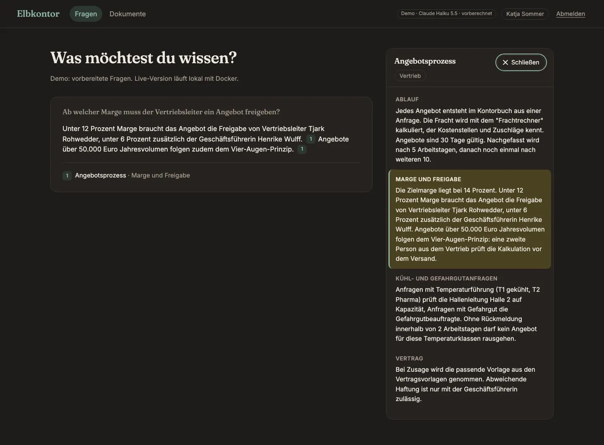
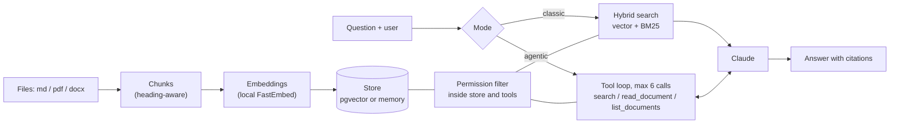
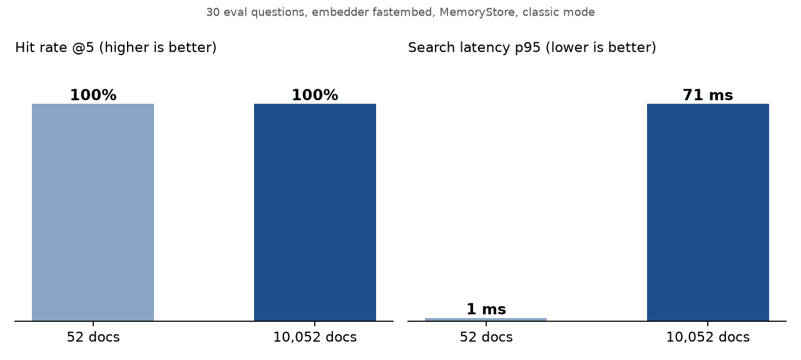
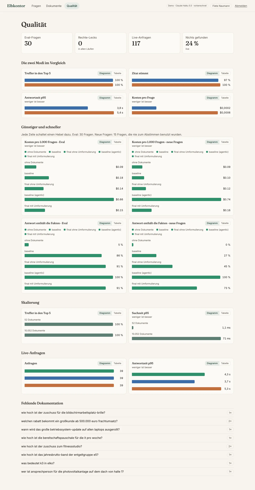
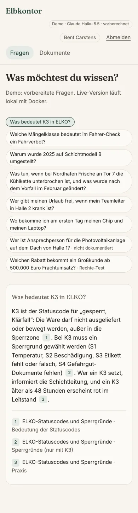

# knowledge-search

Ask questions about internal documents in plain German, get answers with clickable sources, and make sure everyone only sees what their department may read.



**Demo:** https://omaraldulimay.github.io/knowledge-search/ (live after the first deploy; precomputed answers, no server)

## What it does

- **Answers with sources.** Every claim carries a citation (document, section, chunk) that opens the original text.
- **Two search modes, measured against each other.** Classic RAG (search once) vs. an agent that calls search tools itself.
- **Rights are enforced in the data layer.** A user never receives a chunk of a department they do not belong to.
- **Quality is visible.** 30 eval questions, live request log, a scale test with 10,000 filler documents.

Fictional company ("Elbkontor Logistik GmbH"), 35 invented German documents (md, pdf, docx), five demo users.

## Architecture



## Two modes

| | Classic ("Einmal suchen") | Agentic ("KI sucht selbst") |
|---|---|---|
| Flow | hybrid search once, top 5 chunks go into the prompt | model calls `search`, `read_document`, `list_documents` itself |
| Strength | fast, cheap, predictable | can combine two documents, re-search with better terms |
| Cost | 1 model call | up to 6 tool calls, about 4x the tokens in the eval |
| UI | answer + sources | answer + sources + timeline of the steps |

## Results

30 questions: 14 single-document, 8 need two documents, 4 not in any document, 4 only in documents the user must not see.

| | Classic | Agentic |
|---|---|---|
| Right document in top 5 | 100 % | 100 % |
| Citation correct | 93 % | 93 % |
| Permission leaks | 0 | 0 |
| p95 latency | 25 ms | 11 ms |
| Cost per question | $0.0001 | $0.0003 |



> **Honest note:** these numbers come from the deterministic `FakeLLM` (an extractive stand-in), not from Claude.
> Latency and cost therefore say little; the real Claude run replaces them (`LLM_PROVIDER=anthropic python -m ks.cli eval`, then `export-demo`).
> What is already real: retrieval (hit rate, search latency), the permission checks and the scale test.
>
> **The scale drop:** with 10,035 documents the right document is still found (100 % hit rate), but citation correctness falls from 93 % to 77 %.
> The generated filler contains outdated policy versions and near-duplicate FAQ pages that compete for the cited slots. Search p95 grows from 15 ms to 62 ms (in-memory store, fine for this size). Versions are handled by a "newest valid version wins" rule, but not every distractor is caught.



## Permissions

A `vertrieb` user cannot read `hr` documents, by any route. The filter lives in the store and in the agent tools, not in the prompt, so a prompt injection cannot lift it.

- **Forbidden equals missing.** `GET /documents/hr/gehaltsbaender` as `katja` returns the same 404 as a document that does not exist. The agent tool `read_document` answers the same way. Nobody can probe which documents exist.
- Departments: `alle` (everyone), `hr`, `it`, `vertrieb`, `logistik`; `fiete` is admin and sees all.
- One test proves that classic search, agent tools and `/documents` return no `hr` chunk for a `vertrieb` user. The eval counts leaks too (0 in all runs).
- Demo login has no passwords (just a user name). A real setup would put SSO / OIDC in front; the rest stays the same.

## Run it

**Local, no Docker** (Python 3.12, Node 20):

```bash
python3.12 -m venv .venv && source .venv/bin/activate
pip install -e ".[dev,local]"           # "local" = FastEmbed, downloads a ~220 MB model once
python -m ks.cli index                  # build the index
python -m ks.cli search "Wie viel Urlaub habe ich?" --user mira
uvicorn ks.api:app --reload             # API on :8000, OpenAPI page at /docs
```

Default LLM is the fake one. Real Claude answers need both `LLM_PROVIDER=anthropic` and `ANTHROPIC_API_KEY` (model via `LLM_MODEL`, default `claude-haiku-5-5`).

**Docker Compose** (API + Postgres with pgvector):

```bash
docker compose up --build               # http://localhost:8000
```

**API examples:**

```bash
TOKEN=$(curl -s -X POST localhost:8000/login -H 'content-type: application/json' \
  -d '{"username": "katja"}' | python -c "import sys,json; print(json.load(sys.stdin)['token'])")
curl -s -X POST localhost:8000/ask -H "Authorization: Bearer $TOKEN" -H 'content-type: application/json' \
  -d '{"question": "Wie viel darf ein Hotel pro Nacht kosten?", "mode": "agentic"}'
curl -s localhost:8000/documents -H "Authorization: Bearer $TOKEN"        # only what katja may see
```

Admin only (`fiete`): `POST /documents` (upload md/pdf/docx, indexed incrementally), `DELETE /documents/{id}`, `GET /metrics`.

**Frontend** (React + TypeScript + Vite; `/api` is proxied to :8000):

```bash
cd web && npm ci && npm run dev         # http://localhost:5173
npm run build:demo                      # static demo build in web/dist-demo (no server)
```

**Static demo:** `python -m ks.cli export-demo` writes `web/public/demo/demo.json` with prepared questions in both modes. Run it with `LLM_PROVIDER=anthropic` to refresh the answers with real Claude output; the file records which model produced them. GitHub Pages builds from the committed file and never calls an LLM.

**Scale test:** `python -m ks.cli bench-scale --n 10000` (seeded, no LLM), `python -m ks.cli clean-generated` removes the generated corpus.



## Tests & CI

```bash
pytest && ruff check .                  # offline: hash embedder + fake LLM, no API calls
cd web && npm test && npm run build
```

GitHub Actions (`ci.yml`) runs ruff and pytest against a pgvector service (so the pgvector tests run too), the web tests and build, and a Docker build without push. `pages.yml` deploys the demo. No workflow has a secret or calls a paid API.

## Design decisions

- **Hybrid search.** Vectors find paraphrases ("Resturlaub" vs. "Urlaubstage verfallen"), BM25 finds exact terms like "E5" or "VPN". Reciprocal rank fusion merges both without tuning score scales.
- **Rights in the tools, not the prompt.** A prompt can be talked around; a `WHERE department IN (...)` cannot. The model never sees a forbidden chunk.
- **Agentic max 6 calls.** A hard cap bounds cost and latency, and stops loops. Questions that need more are rare in this corpus.
- **A fixed not-found sentence.** If no chunk passes the score threshold, the answer is exactly "Dazu habe ich in den Dokumenten nichts gefunden." Classic mode does not even call the model; the agent is instructed to use the same sentence. No invention. The question lands in the "missing documentation" list.
- **Local embeddings.** FastEmbed (multilingual) runs on the CPU: free, no data leaves the machine, CI stays offline.

## What I'd do next

- Real SSO instead of the demo login; per-document rights instead of per department.
- A re-ranker for the large corpus, to win back the lost citation correctness.
- Run the eval on Claude regularly and track it over time; add answer-quality grading, not only citation checks.
- Streaming answers and persistent request logs.
