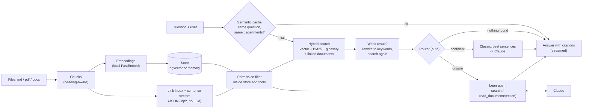

# knowledge-search

Ask questions about **internal** documents in plain German, get answers with clickable sources, and make sure everyone only sees what their department may read.


**Demo:** https://omaraldulimay.github.io/knowledge-search/ (live after the first deploy; precomputed answers, no server)

## What it does

- **Answers only the company can give.** The corpus is full of things no public chatbot knows: the warehouse system "ELKO" and its status codes (K1 to K5), extensions of the on-call phone, approval limits, customer contracts, incident reports, the reason a shift model was changed. "Was bedeutet K3 in ELKO?" is impossible to answer without the documents; the numbers below prove it (Claude without documents: 5 % / 0 % of the facts right).
- **Answers with sources.** Every claim carries a citation (document, section, chunk) that opens the original text. Where a rule has an old and a new version, the newest valid one wins.
- **Three search modes, measured against each other.** Classic RAG (search once), an agent that calls search tools itself, and `auto`, which picks one per question from the search results.
- **Rights are enforced in the data layer.** A user never receives a chunk of a department they do not belong to.
- **Quality and cost are visible.** 30 tuning questions plus two held-out sets of 15, a "without our search" comparison, live request log, a scale test with 10,000 filler documents, an ablation of every cost lever.

Fictional company ("Elbkontor Logistik GmbH", Hamburg), 52 invented German documents (md, pdf, docx), five demo users. See `data/README.md` for the corpus.

## Architecture



## Three modes

| | Auto (default) | Classic ("Einmal suchen") | Agentic ("KI sucht selbst") |
|---|---|---|---|
| Flow | search (rewritten and repeated if weak), then the router decides | hybrid search once, best sentences go into the prompt | model calls `search`, `read_document(doc, section)`, `list_documents` itself |
| Strength | cheap for easy questions, thorough for unsure ones, free when nothing is found | fast, cheap, predictable | can combine two documents, re-search with better terms |
| Cost | between the two, see the ablation below | 1 model call | up to 4 tool calls (6 in the baseline agent) |
| UI | answer + sources + what the router chose | answer + sources | answer + sources + timeline of the steps |

## Results

### Without our search, Claude knows nothing

Every answerable question was also sent to Claude Haiku 5.5 **without any document** (one short prompt, `max_tokens` 150) and scored with the same fact checker (`python -m ks.cli optimize --real --nodocs-only`). The questions are about "ELKO", "Lotse", "Tor 7", "Nordhafen Frische" and so on, so a model without the documents can only say that it does not know.

| | Tuning (22 answerable of 30) | Held-out (11 answerable of 15) |
|---|---|---|
| Claude **without** documents: facts right | **5 %** (1 of 22) | **0 %** (0 of 11) |
| Our search, classic baseline | 86 % | 27 % |
| Our search, final `auto` (with query rewrite) | **91 %** | **73 %** |
| Our search, agent (every question) | 100 % | 100 % |

The one hit without documents is the question about parental leave: the 1/12-per-month rule for cutting vacation is public law, only the 30 days are internal. The held-out classic baseline is low for a reason explained below (its strict relevance gate says "not found" too often).

### The final system against its targets (round 4)

The first version of `auto` reached only 73 % facts on colloquial held-out questions. Round 4 fixed the cheap path itself, without sending more questions to the agent. Three changes, each a switch in `ks/config.py`:

1. **A better local embedding model** (`google/embeddinggemma-300m` instead of MiniLM, free, about 1.2 GB, ~3x slower to index).
2. **Doc2query**: once at index time Claude Haiku writes 4 colloquial questions per chunk (`data/doc2query.json`, committed, one-time cost $0.026, no API at runtime or in CI). They are searched next to the chunk by vector and keyword.
3. **A local cross-encoder reranker** (`jina-reranker-v2-base-multilingual`) reorders the best 8 hybrid hits. Free, but adds about 0.7 s.

The router now sends a question to the agent only if it is an explicit two-part question and the two halves find *different* documents.

Real Claude Haiku 5.5, mode `auto`, no cache (`eval/optimization.json`). Tuning and the old held-out set were used for tuning; **held-out 2** (15 new colloquial questions, `eval/holdout2.yaml`) was committed before the work and evaluated once at the end.

| | Tuning (30) | Held-out (15) | Held-out 2 (15) | Target |
|---|---|---|---|---|
| Fact correct | 95 % | 91 % | **100 %** | at least 90 % |
| Citation correct | 97 % | 100 % | 100 % | at least 95 % |
| Permission leaks | 0 | 0 | 0 | 0 |
| Routed to the agent | 10 % | 20 % | 7 % | at most 10 % |
| p50 latency | 1.8 s | 2.0 s | 1.9 s | 1.5 s |
| $ per 1,000 questions | 0.18 | 0.21 | 0.16 | 0.15 |
| Claude without documents (facts) | 5 % | 0 % | 9 % | – |
| Previous version (round 2 + rewrite) | 91 % | 73 % | not measured | – |

Quality targets are met on all three sets. **Missed:** p50 (the reranker costs ~0.7 s), cost per 1,000 (agent share and longer prompts), and the agent share on the old held-out set (3 of 15 questions are two-part questions with two documents). The citation miss on tuning is one question.

Offline levers measured one by one on top of round 2 (free, fake model, `facts in prompt` = did the facts reach the prompt):

| Lever alone | Tuning both docs / facts | Held-out both docs / facts |
|---|---|---|
| none (round 2) | 95 % / 91 % | 73 % / 60 % |
| 1 embedding model | 100 % / 91 % | 82 % / 73 % |
| 2 reranker | 95 % / 95 % | 73 % / 80 % |
| 4 doc2query | 91 % / 95 % | 91 % / 91 % |
| 1 + 2 + 4 (final) | 100 % / 95 % | 91 % / 82 % |

Not kept: **contextual chunk headers** (department in the embedded text) gave nothing on the held-out set and **a model-generated glossary** (324 groups) was noisy and did not help; both were removed from the code. The **query rewrite** (lever 6) is off in the final configuration and was not re-measured with the new retrieval; the code is still there. Only one real run per configuration, 11 to 22 answerable questions per set: differences of one question are noise. The numbers on held-out 2 are an honest first look, not a tuned value. Not explored for lack of time: `multilingual-e5-large` (2.2 GB, too slow to index here), Qwen3 embeddings, a faster reranker or reranking only uncertain questions (would bring p50 down), and larger question sets.

Total real API spend for round 4: about $0.05 (doc2query $0.026, discarded glossary experiment $0.012, final runs $0.012).

### Classic against agentic, the plain baseline

Real run with **Claude Haiku 5.5** (`claude-haiku-5-5`), 30 tuning questions, all optimisation levers off (`eval/results.json`):

| | Classic | Agentic |
|---|---|---|
| Right document in top 5 | 100 % | 100 % |
| Both documents retrieved (answerable questions) | 95 % | 95 % |
| Citation correct / "not found" correct | 97 % | 100 % |
| Permission leaks | 0 | 0 |
| Latency avg / p95 | 1.6 s / 3.8 s | 3.0 s / 5.4 s |
| Avg tokens per question (in / out) | 869 / 190 | 4,518 / 373 |
| Cost per question | $0.00018 | $0.00064 |
| Cost for all 30 questions | $0.0055 | $0.0191 |

The 30 tuning questions: 14 single-document, 8 need two documents, 4 not in any document, 4 only in documents the user must not see. The 15 held-out questions (`eval/holdout.yaml`) have the same mix, are written in everyday employee language and were committed before any tuning.

## Kosten & Tempo optimieren

Six levers, each one switchable (`ks/config.py`), measured one after the other (`python -m ks.cli optimize`, results in `eval/optimization.json`, every real answer in `eval/optimization_answers.json`). The goal: cheaper and faster than the agent **without** losing the answers, through retrieval design instead of prompt tweaks.

**How it was measured.** Prices: $0.10 / $0.50 per million tokens. Real runs (Claude Haiku 5.5, one run per row) were done for the rows that matter: *no documents*, *baseline*, *baseline (agentic)*, *final (round 2)* (everything but the rewrite) and *final + rewrite*. All other rows ran **offline** with the fake model (free, deterministic): hit@5, "both docs", leaks and routing do not need a model, and **"facts in prompt"** checks, without any model, whether the facts of the right answer survived retrieval and compression and actually reached the prompt. Answer facts, citations, time and cost need the real model, so offline rows show a dash there. Total API spend for this whole content rework, including the demo export and the plain eval: about $0.09. "fact" = the answer contains the numbers and terms of the right answer (`eval/facts.yaml`); "citation" = cites the right document, or says "not found" when it should. Glossary, links and router were tuned on the tuning questions only.

**Tuning set (30 questions)**

| Configuration | measured | hit@5 | both docs | facts in prompt | fact correct | citation | leaks | agent | p50 | $ / 1,000 |
|---|---|---|---|---|---|---|---|---|---|---|
| no documents | real | – | – | – | 5% | – | 0 | – | 1.43 s | $0.09 |
| baseline | real | 100% | 95% | 90% | 86% | 97% | 0 | 0% | 1.19 s | $0.18 |
| +compression | offline | 100% | 95% | 90% | – | – | 0 | 0% | – | – |
| +glossary | offline | 100% | 95% | 91% | – | – | 0 | 0% | – | – |
| +graph | offline | 100% | 95% | 91% | – | – | 0 | 0% | – | – |
| +router (auto) | offline | 100% | 95% | 91% | – | – | 0 | 3% | – | – |
| +cache (43 q. with repeats) | offline | 100% | 97% | 92% | – | – | 0 | 2% | – | – |
| baseline (agentic) | real | 100% | 95% | 100% | 100% | 100% | 0 | 100% | 2.82 s | $0.66 |
| agentic (all levers) | offline | 100% | 95% | 91% | – | – | 0 | 100% | – | – |
| final (round 2) | real | 100% | 95% | 91% | 91% | 100% | 0 | 3% | 1.23 s | $0.14 |
| final + rewrite | real | 100% | 95% | 91% | 91% | 100% | 0 | 3% | 2.10 s | $0.15 |

**Held-out set (15 questions)**

| Configuration | measured | hit@5 | both docs | facts in prompt | fact correct | citation | leaks | agent | p50 | $ / 1,000 |
|---|---|---|---|---|---|---|---|---|---|---|
| no documents | real | – | – | – | 0% | – | 0 | – | 1.41 s | $0.09 |
| baseline | real | 100% | 82% | 67% | 27% | 60% | 0 | 0% | 0.01 s | $0.10 |
| +compression | offline | 100% | 82% | 67% | – | – | 0 | 0% | – | – |
| +glossary | offline | 100% | 73% | 67% | – | – | 0 | 0% | – | – |
| +graph | offline | 100% | 73% | 67% | – | – | 0 | 0% | – | – |
| +router (auto) | offline | 100% | 73% | 60% | – | – | 0 | 0% | – | – |
| +cache (21 q. with repeats) | offline | 94% | 76% | 62% | – | – | 0 | 0% | – | – |
| baseline (agentic) | real | 100% | 91% | 100% | 100% | 100% | 0 | 100% | 2.81 s | $0.74 |
| agentic (all levers) | offline | 91% | 64% | 64% | – | – | 0 | 100% | – | – |
| final (round 2) | real | 100% | 73% | 60% | 45% | 87% | 0 | 0% | 1.23 s | $0.12 |
| final + rewrite | real | 100% | 91% | 73% | 73% | 93% | 0 | 0% | 2.18 s | $0.16 |

*Read the tables with care.* Every real run is one sample of a model whose temperature cannot be set, and with 22 / 11 answerable questions a difference of one or two questions is noise. The baseline row on the held-out set looks fast and cheap only because its strict relevance gate answered "not found" to 9 of 15 questions without a model call (citation 60 %, only 6 questions reached the model). The `+cache` rows run a workload with about 30 % repeats (43 and 21 requests). "Agent" is the share of questions the agent answered; for `baseline (agentic)` it is every question by definition.

### The levers

1. **Document links ("graph-lite").** At ingest a JSON index (`links.json`) links documents by (a) explicit references (a document names another's title or file name, or "siehe ..."), (b) TF-IDF key terms per document, (c) rare key terms two documents share. At search time the best chunk of a strongly linked document is added if it is similar enough to the question. Permissions are applied inside the store, so a link into a forbidden department adds nothing (tests in `tests/test_optimize.py`). *Effect on this corpus:* none that the tuning set can see (both docs 95 % before and after); the links mostly add a weak extra chunk, which the compression then drops.
2. **Glossary / query expansion.** `data/glossary.yaml` holds synonym groups and the company's own vocabulary (bAV, Urlaub/Ferien, HO, MFA, ELKO/Lagersystem, Lerntopf/Bildungsbudget, Bereitschaft, Annahmeschluss/Cut-off, Kühlkette, K3/gesperrt, ...), curated from the documents; acronym and compound groups are seeded automatically (`python -m ks.cli seed-glossary`). A matching word adds its group to the BM25 query. *Effect:* "facts in prompt" 90 % to 91 % on the tuning set; on the held-out set offline "both docs" went from 82 % to 73 % (one question), so the glossary did not generalise to colloquial wording here. *Caveat:* the groups were written from the documents, not from the held-out questions.
3. **Context compression.** Each section is cut down to its best sentences, scored by meaning (embedding similarity, computed once at ingest) plus exact question words, with every sentence that holds a number kept; sections are merged, overlap is dropped, at most four go into the prompt, cited as [1], [2] and mapped back to (document, section, chunk) in code. The system prompt is short, answers are limited to four sentences, and the model's own thinking is switched off for these extractive answers. *Effect on the real runs (questions that reached the model):* median input 1,184 tokens (baseline) to 798 (final), median output 137 to 86. *Cost of it:* "facts in prompt" does not drop (90 % to 91 %), but the compressed prompt sometimes keeps the wrong section of a long document (m03 loses the extension 5299).
4. **Adaptive router (`auto`).** No model call: after the hybrid search it routes by retrieval signals. Both keyword and vector score weak: answer the not-found sentence directly (zero calls). A two-part question ("... und wie ...") whose two best documents both match strongly: agentic. Otherwise classic. The agent got leaner too: short tool descriptions, one-line snippets, `read_document(doc, section)` returns only that section, short citation keys. *Effect:* only 3 % of the tuning questions and 0 % of the held-out questions go to the agent. I first let the "second document matches at 0.5" rule decide (20 % to the agent), but with 52 documents many unrelated ones score 0.5, so the bar for the second document is now the same as for the first (0.65). *Cost of it:* two multi-document questions (m02, m03) that the agent answers completely now depend on the classic prompt, and the classic prompt misses part of the answer for them.
5. **Semantic cache + streaming.** An answer is reused when the question embedding has cosine >= 0.95 **and** the department set (and mode) is identical; never across scopes (test). On the paraphrase workload (templates, no LLM) repeats hit and no new question is wrongly served; a hit costs nothing. `/ask/stream` sends server-sent events (`delta`, then `done` with the citations); the UI renders the text while it arrives. The static demo stays precomputed.
6. **Query rewrite for weak searches.** If the best vector score of the first search is below 0.6, one tiny Claude call (about 120 tokens in, 25 out) turns the question into search keywords, the search runs again and both result lists are merged (`ks/rewrite.py`). Strong searches never pay for it. *Effect (real):* held-out fact 45 % to 73 %, citation 87 % to 93 %, both docs 73 % to 91 %; tuning unchanged. *Cost:* +$0.011 / +$0.047 per 1,000 questions and +0.9 s at p50, because 10 of 30 tuning questions and 12 of 15 held-out questions start with a weak search.

**Prompt caching: not applicable.** Haiku 5.5 caches prefixes of at least 512 tokens. The optimised prompts have a fixed prefix (system prompt + tool definitions) of roughly 120 tokens (classic) and 400 tokens (lean agent), below that.

### What did not help, or got worse

- **The cheap path does not reach the agent on colloquial questions.** The agent re-phrases its own searches and reads whole sections, which is why it scores 100 %. Classic with rewrite closes about half the gap on the held-out set; the rest is retrieval that a keyword rewrite cannot fix (multi-document questions where the second document shares no words with the question).
- **Latency got worse, not better.** `final + rewrite` has a p50 of 2.1 s against 1.2 s for classic alone, because most weak searches make two model calls. The agent is 2.8 s.
- **Cost target missed by a hair.** $0.151 per 1,000 on the tuning set, $0.163 on the held-out set, against a target of $0.15. The rewrite is the reason; without it the numbers are $0.140 and $0.116 but the held-out answers are much worse.
- **Glossary and links did not help the held-out wording.** Both were tuned on the tuning set, where retrieval was already good; they changed nothing there.
- **The fact check is strict and the sample is small.** 22 and 11 answerable questions: one question is 4.5 % / 9 %.
- **Router thresholds** are calibrated on 30 questions, and colloquial wording scores lower vectors, which the rewrite now compensates only partly.


> **Which numbers come from which model:** the real rows of the tables (answer facts, citation, latency, tokens, cost) are from Claude Haiku 5.5. Retrieval (hit rate, search latency), the permission checks, the "facts in prompt" column and the scale test are model-independent; the scale test used the deterministic `FakeLLM` for its citation numbers.
>
> **The scale drop:** with 10,052 documents the right document is still found (100 % hit rate), but citation correctness falls from 93 % to 77 % (fake model, classic mode). The generated filler contains outdated policy versions and near-duplicate FAQ pages that compete for the cited slots. Search p50 grows from 0.5 ms to 23 ms and p95 from 1 ms to 71 ms (in-memory store, 38,377 chunks, 75 MB index, 1.3 GB peak memory, 11.6 minutes to index on the dev laptop). Versions are handled by a "newest valid version wins" rule, but not every distractor is caught.


## Permissions

A `vertrieb` user cannot read `hr` documents, by any route. The filter lives in the store and in the agent tools, not in the prompt, so a prompt injection cannot lift it.

- **Forbidden equals missing.** `GET /documents/hr/gehaltsbaender` as `katja` returns the same 404 as a document that does not exist. The agent tool `read_document` answers the same way. Nobody can probe which documents exist.
- Departments: `alle` (everyone), `hr`, `it`, `vertrieb`, `logistik`; `fiete` is admin and sees all.
- One test proves that classic search, agent tools and `/documents` return no `hr` chunk for a `vertrieb` user. The eval counts leaks too (0 in all runs).
- Demo login has no passwords (just a user name). A real setup would put SSO / OIDC in front; the rest stays the same.

## Run it

**Local, no Docker** (Python 3.12, Node 20):

```bash
python3.12 -m venv .venv && source .venv/bin/activate
pip install -e ".[dev,local]"           # "local" = FastEmbed, downloads a ~220 MB model once
python -m ks.cli index                  # build the index
python -m ks.cli search "Was bedeutet K3 in ELKO?" --user bent
uvicorn ks.api:app --reload             # API on :8000, OpenAPI page at /docs
```

Ingest also writes `links.json` and `sentences.npz` next to the index. Default LLM is the fake one (tests and CI never call the API). Real Claude answers need both `LLM_PROVIDER=anthropic` and `ANTHROPIC_API_KEY` (model via `LLM_MODEL`, default `claude-haiku-5-5`).

**Docker Compose** (API + Postgres with pgvector):

```bash
docker compose up --build               # http://localhost:8000
```

**API examples:**

```bash
TOKEN=$(curl -s -X POST localhost:8000/login -H 'content-type: application/json' \
  -d '{"username": "katja"}' | python -c "import sys,json; print(json.load(sys.stdin)['token'])")
curl -s -X POST localhost:8000/ask -H "Authorization: Bearer $TOKEN" -H 'content-type: application/json' \
  -d '{"question": "Bis wann ist Annahmeschluss für Seeger Pharma Großhandel?", "mode": "auto"}'     # auto | classic | agentic
curl -sN -X POST localhost:8000/ask/stream -H "Authorization: Bearer $TOKEN" -H 'content-type: application/json' \
  -d '{"question": "Wer gibt meine Vertriebsreise für 1.800 Euro frei?"}'     # server-sent events: delta ... done
curl -s localhost:8000/documents -H "Authorization: Bearer $TOKEN"        # only what katja may see
```

Admin only (`fiete`): `POST /documents` (upload md/pdf/docx, indexed incrementally), `DELETE /documents/{id}`, `GET /metrics`.

**Frontend** (React + TypeScript + Vite; `/api` is proxied to :8000):

```bash
cd web && npm ci && npm run dev         # http://localhost:5173
npm run build:demo                      # static demo build in web/dist-demo (no server)
```

**Static demo:** `python -m ks.cli export-demo` writes `web/public/demo/demo.json` with prepared questions in all three modes (`auto` is the default). Run it with `LLM_PROVIDER=anthropic` to refresh the answers with real Claude output (answers from the ablation run are reused); the file records which model produced them. GitHub Pages builds from the committed file and never calls an LLM.

**Ablation:** `python -m ks.cli optimize` (offline, free) or `... optimize --real --nodocs --budget 0.05` (real model, costs money; `--configs` picks rows, `--nodocs-only` runs only the "without documents" comparison), then `python -m ks.cli optimize-table` for the markdown tables. `KS_CONFIG=baseline` turns every lever off in the API.

**Scale test:** `python -m ks.cli bench-scale --n 10000` (seeded, no LLM), `python -m ks.cli clean-generated` removes the generated corpus.


## Tests & CI

```bash
pytest && ruff check .                  # offline: hash embedder + fake LLM, no API calls
cd web && npm test && npm run build
```

GitHub Actions (`ci.yml`) runs ruff and pytest against a pgvector service (so the pgvector tests run too), the web tests and build, and a Docker build without push. `pages.yml` deploys the demo. No workflow has a secret or calls a paid API.

## Design decisions

- **Hybrid search.** Vectors find paraphrases ("Resturlaub" vs. "Urlaubstage verfallen"), BM25 finds exact terms like "E5" or "VPN". Reciprocal rank fusion merges both without tuning score scales.
- **Rights in the tools, not the prompt.** A prompt can be talked around; a `WHERE department IN (...)` cannot. The model never sees a forbidden chunk.
- **Agentic max 6 calls.** A hard cap bounds cost and latency, and stops loops. Questions that need more are rare in this corpus.
- **Cheap decisions before expensive ones.** Everything the router, the links and the cache need is computed from the search that has to run anyway. The one exception is the query rewrite, which spends a tiny model call only when the first search is weak.
- **A fixed not-found sentence.** If no chunk passes the score threshold, the answer is exactly "Dazu habe ich in den Dokumenten nichts gefunden." Classic mode does not even call the model; the agent is instructed to use the same sentence. No invention. The question lands in the "missing documentation" list.
- **Local embeddings.** FastEmbed (multilingual) runs on the CPU: free, no data leaves the machine, CI stays offline.

## What I'd do next

- Real SSO instead of the demo login; per-document rights instead of per department.
- A re-ranker for the large corpus, to win back the lost citation correctness, and a better answer for questions that need two documents that share no words (today only the agent gets those right).
- Run the eval on Claude regularly and track it over time; add answer-quality grading, not only citation checks.
- Persistent request logs; a cross-encoder re-ranker as a better second opinion than the two-signal router.
- Grade answers with a rubric instead of fact strings, and repeat the real runs a few times to put error bars on the tables.
