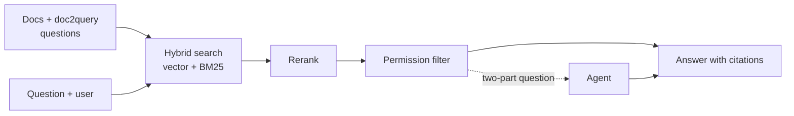

# knowledge-search

Ask questions about **internal** company documents in plain German and get answers with clickable sources, while every user only sees what their department may read. Fictional company ("Elbkontor Logistik GmbH"), 52 invented documents (md, pdf, docx), five demo users.


**Demo:** https://omaraldulimay.github.io/knowledge-search/ (precomputed answers, no server)

## Why

The documents hold things no public model knows: the warehouse system "ELKO" and its status codes, on-call extensions, approval limits, customer contracts. I asked Claude Haiku 5.5 the same answerable questions without any document and scored the facts in its answer:

| Facts right | Tuning (30 q.) | Held-out (15) | Held-out 2 (15) |
|---|---|---|---|
| Claude **without** documents | 5 % | 0 % | 9 % |
| Claude **with** this search | **95 %** | **91 %** | **100 %** |

## How it works



1. **Ingest.** Heading-aware chunks, local embeddings (`embeddinggemma-300m`). Once, Claude writes 4 colloquial questions per chunk (doc2query, committed in `data/doc2query.json`, so no API at runtime or in CI).
2. **Hybrid search.** Vector search and BM25 over chunks and generated questions, merged by reciprocal rank fusion.
3. **Rerank.** A local cross-encoder (`jina-reranker-v2-base-multilingual`) reorders the best hits.
4. **Permission filter.** Enforced in the store and the agent tools, not in the prompt. Forbidden documents look like missing ones (same 404). 0 leaks in all runs.
5. **Answer with citations.** Best sentences go to Claude, every claim cites document and section. Nothing found gives a fixed "not found" sentence without a model call. Only explicit two-part questions go to a tool-using agent.

## Results

Real Claude Haiku 5.5, no cache. Held-out sets were written before tuning; held-out 2 was run once at the end.

| | Tuning (30) | Held-out (15) | Held-out 2 (15) |
|---|---|---|---|
| Facts right | 95 % | 91 % | 100 % |
| Citation correct | 97 % | 100 % | 100 % |
| Permission leaks | 0 | 0 | 0 |
| Cost per 1,000 questions | $0.18 | $0.20 | $0.16 |
| Latency p50 | 1.8 s | 2.0 s | 1.9 s |

For comparison, an agent that answers every question reaches 100 % facts but costs $0.66 to $0.74 per 1,000 and takes 2.8 s at p50.

## What I learned

- Colloquial wording was the weak spot (73 % on the first held-out set). A better embedding model, doc2query and a reranker fixed it in the cheap path instead of sending more questions to the agent.
- The reranker costs about 0.7 s per question. That misses my 1.5 s latency target; skipping it for confident searches would be the next step.
- Levers that did not help (contextual chunk headers, a generated glossary) were removed. The query rewrite is switched off in the final setup; its code is still there.
- Samples are small (11 to 22 answerable questions per set, one real run each): one question is 5 to 9 points. Treat the numbers as a first look.
- Full history, all levers and the 10,000-document scale test: [docs/EVALUATION.md](docs/EVALUATION.md).


## Run locally

```bash
python3.12 -m venv .venv && source .venv/bin/activate
pip install -e ".[dev,local]"           # FastEmbed + local models, downloaded once
python -m ks.cli index                  # build the index
python -m ks.cli search "Was bedeutet K3 in ELKO?" --user bent
uvicorn ks.api:app --reload             # API on :8000, docs at /docs
cd web && npm ci && npm run dev         # UI on :5173
```

The default LLM is a fake one, so tests and CI never call the API. Real answers need `LLM_PROVIDER=anthropic` and `ANTHROPIC_API_KEY`. Docker: `docker compose up --build`. Tests: `pytest && ruff check .` and `cd web && npm test && npm run build`. Refresh the static demo with `python -m ks.cli export-demo`.


